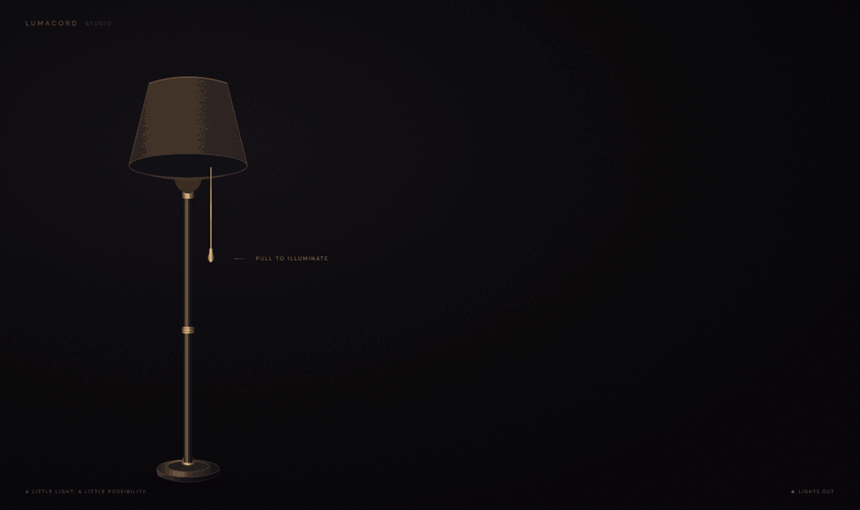
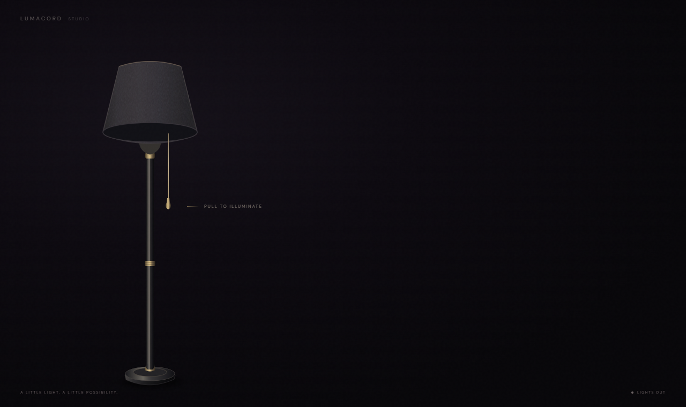
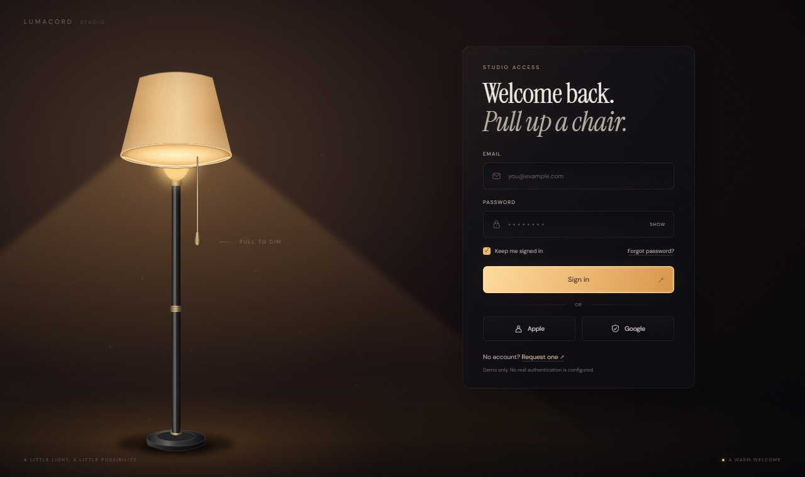

# LumaCord

**Cinematic Lamp-Powered Login UI**

*Pull the cord. Illuminate the experience.*

A frontend login scene built around a warm floor lamp, a physical pull cord, and a carefully timed form reveal. Use it as a standalone showcase or connect its typed submission callback to your own application. The existing Vite + TypeScript implementation is preserved; no backend or authentication service is included.

[](https://github.com/RamziFalah5/lumacord/actions/workflows/ci.yml)



| Lights off | Lights on |
| --- | --- |
|  |  |

[**Live demo**](https://ramzifalah5.github.io/lumacord/) · [Full preview video (MP4)](https://github.com/RamziFalah5/lumacord/releases/download/v1.0.0/lumacord-preview.mp4) · [Mobile screenshot](media/mobile-on.png)

These screenshots and the GIF are genuine captures of the running application.

## Features

- Original SVG lamp materials, light beams, warm washes, shadows, grain, and floating dust.
- Pointer dragging with a damped spring; click, touch, Enter, and Space activation.
- Staggered panel reveal, hidden-form focus protection, and reduced-motion support.
- Email/password validation, password visibility, async loading, duplicate-submit protection, and visible errors.
- Typed backend callbacks, optional social/recovery/account actions, and explicit demo feedback.
- Local fonts and assets; the showcase makes no authentication requests and stores no credentials.

## Quick start

Use **Node.js 24** and npm:

```sh
git clone https://github.com/RamziFalah5/lumacord.git
cd lumacord
npm ci
npm run dev
```

Open the local URL printed by Vite. Pull the cord to reveal the form. Any valid email and nonempty password can exercise the demo; submission displays an explicit “Demo only” message. No account is created or authenticated.

On Windows, use `npm.cmd` if PowerShell blocks `npm.ps1`.

```sh
npm run typecheck
npx playwright install chromium
npm test
npm run build
npm run test:production
npm run audit
npm run preview
```

The production build targets `/lumacord/`; local development stays at the root URL. The GitHub Actions workflow validates the project and deploys verified `main` builds to Pages. See [Vite's base-path guidance](https://vite.dev/guide/build#public-base-path).

## Backend integration

Import the source into a Vite-compatible application with the two Fontsource dependencies installed. This is a reusable source project, not a published npm package.

```ts
import { mountLampLogin, LampLoginError } from './src/lamp-login';
import type { LoginCredentials } from './src/lamp-login';

const login = mountLampLogin(document.querySelector<HTMLElement>('#login')!, {
  async onSubmit(credentials: LoginCredentials, { signal }) {
    const response = await fetch('/api/login', {
      method: 'POST',
      headers: { 'Content-Type': 'application/json' },
      credentials: 'same-origin',
      signal,
      body: JSON.stringify(credentials),
    });
    if (!response.ok) throw new LampLoginError('Sign-in failed. Please try again.');
    // The host handles the authenticated session and navigation here.
  },
});

// When your view unmounts:
login.destroy();
```

`LoginCredentials` contains `{ email: string; password: string; remember: boolean }`. The component owns validation, loading, and error presentation. A resolved callback leaves success handling to the host; rejection with `LampLoginError` displays an intentionally public message. Other exceptions display a generic error.

The example endpoint must be supplied by your application. A real integration also needs its server's CSRF protection and session policy. Read [the integration guide](docs/INTEGRATION.md) for a fuller REST example, CORS/CSRF notes, optional callbacks, and React lifecycle usage.

## Customization

Set `brandName`, `brandSuffix`, `accentColor`, or selected `text` values without changing the lamp and reveal choreography. Defaults retain the original warm palette and form copy. The standalone demo adds a clear authentication notice. [Customization guide](docs/CUSTOMIZATION.md).

## Tech stack and structure

Vite, strict TypeScript, native DOM/SVG/CSS, DM Sans and Instrument Serif through Fontsource. Playwright provides browser tests. There is no runtime UI framework or animation dependency.

```text
src/
  lamp-login.ts   Public mount API and customization
  auth.ts         Credentials, callbacks and public error type
  scene.html      Original lamp and form markup
  motion.ts       Cord physics, lamp state and focus transitions
  form.ts         Validation, async state and external actions
  style.css       Scene styling, fonts and original choreography
  main.ts         Standalone demo
public/           Favicon and font license notices
tests/            Browser behavior tests and isolated harness
scripts/          Media capture and release hygiene checks
media/            Genuine screenshots and preview GIF
docs/             Integration, customization and architecture
.github/workflows/ci.yml
```

## Accessibility and compatibility

The cord is a native toggle button with an accessible name and pressed state. The form remains inert while hidden, and focus returns to the cord when it closes. Inputs have associated labels, visible focus styles, autocomplete hints, and announced feedback. Reduced motion disables dust and spring settling and shortens CSS transitions.

The scene is intended for a full-page view. Desktop composition scales from 1280 × 760; at 700px and below it becomes a vertically scrolling layout. Automated verification currently covers Chrome on Windows and emulated mobile touch, not physical devices, Safari, Firefox, or a screen-reader audit. Modern support for Pointer Events, `inert`, ResizeObserver, and CSS `:has()` is required. The restrained original typography and contrast have not been certified for WCAG conformance.

## License and credits

Released under the [MIT License](LICENSE), copyright (c) 2026 Ramzi Abu Falah. The owner confirmed that the initial application was generated from scratch with AI coding assistance; external video/screenshots supplied visual inspiration and are not redistributed. See [provenance and licensing](docs/PROVENANCE.md) for project material, AI-assisted additions, dependencies and excluded references. No endorsement by reference creators is claimed.

The optional Apple and Google actions use neutral project-drawn icons. Provider names are descriptive text; no endorsement, partnership, certification or official integration is claimed. The `'apple' | 'google'` callback identifiers are unchanged, and real provider integration belongs to the host application.

DM Sans and Instrument Serif are distributed under the SIL Open Font License 1.1. Their complete notices are retained in [public/licenses](public/licenses). Font packages supply the local font files used in the build.

Private reference media and analysis files remain local and ignored. They are not production assets. See [architecture and release notes](docs/ARCHITECTURE.md) for implementation and verification scope.
